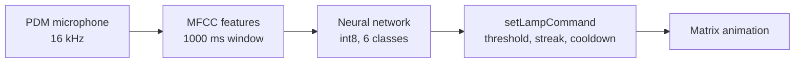

# VoiceLamp

A voice-controlled lamp built from an 8x8 NeoPixel matrix and an Arduino Nano 33 BLE Sense. A small keyword-spotting model trained in Edge Impulse runs on the board and recognises four spoken commands: **light**, **dim**, **off** and **disco**. All audio processing and classification happens on the device. No network connection or cloud service is used at run time.

## Commands

| Say | Lamp behaviour |
|---|---|
| **light** | Warm white circle at full size, brightness 60 |
| **dim** | Smaller warm white circle, brightness 25 |
| **off** | Matrix off |
| **disco** | White sparkle, random pixels twinkle and fade, until another command is heard |

Changes between states are animated: the circle grows or shrinks towards its target size and brightness rather than jumping.

## How it works



The microphone feeds a rolling 1000 ms window. The model classifies the window every 125 ms (8 slices per window). The class with the highest score in each slice goes to `setLampCommand()`, which acts only if all of these hold:

1. The label is one of the four commands.
2. The score meets that command's own threshold.
3. For disco, the same result has appeared in two consecutive slices.
4. At least 800 ms have passed since the last command.

Anything classified as `background` or `unknown` is ignored.

## Hardware

| Part | Notes |
|---|---|
| Arduino Nano 33 BLE Sense | Uses the onboard PDM microphone |
| 8x8 NeoPixel matrix (WS2812B type) | Zigzag layout, GRB, 800 kHz, origin top left |

Wiring, as defined in the sketch:

| Matrix | Nano 33 BLE Sense |
|---|---|
| DIN | D6 |
| GND | GND |
| 5V | 5V supply |

The sketch caps matrix brightness at 60 (out of 255) to keep current draw low. Check your own supply arrangement before raising it.

## Software requirements

- Arduino IDE 2.x or `arduino-cli`
- Board package: **Arduino Mbed OS Nano Boards**
- Libraries (Library Manager):
  - Adafruit NeoMatrix (installs Adafruit GFX Library and Adafruit NeoPixel as dependencies)
  - Arduino_LSM9DS1 and Arduino_OV767X, which the Edge Impulse library lists as dependencies and the IDE may ask for
- The Edge Impulse model library, `VoiceLamp_JandM_inferencing` (included in `lib/`)

`PDM` ships with the board package.

## Getting started

1. Clone this repository.
2. Install the Arduino Mbed OS Nano Boards package and the libraries listed above.
3. In the Arduino IDE, choose **Sketch > Include Library > Add .ZIP Library** and select the zip in `lib/`.
4. Open `VoiceLamp/VoiceLamp.ino`. The sketch must stay inside a folder called `VoiceLamp`.
5. Select **Arduino Nano 33 BLE** and its port, then upload.
6. Open the Serial Monitor at **115200** baud and speak a command.

The sketch waits up to 3 seconds for the Serial Monitor at start-up, then carries on, so the lamp also runs when powered without a computer.

## Model

| | |
|---|---|
| Edge Impulse project | VoiceLamp_JandM (deployment version 11) |
| Input | 16 kHz audio, 1000 ms window (16,000 samples) |
| Features | MFCC: 13 cepstral coefficients, 20 ms frames, 32 filters, 256-point FFT |
| Classes | `background`, `dim`, `disco`, `light`, `off`, `unknown` |
| Format | Quantised int8, EON compiled, TensorFlow Lite |
| Slices per window | 8 (125 ms stride), set in the sketch |

Validation results at export (Studio validation set, accuracy 97.6%, loss 0.15):

| Class | F1 score |
|---|---|
| background | 0.99 |
| dim | 0.95 |
| disco | 0.91 |
| light | 0.93 |
| off | 0.94 |
| unknown | 0.95 |

Most remaining errors are commands classified as `unknown`, which makes the lamp ignore a command and leaves it in its current state. Validation sets are small, so treat single-class percentages as approximate. Live behaviour with new voices and rooms matters more than these figures.

### Training data

Clips are 1000 ms, 16 kHz, recorded with the same microphone the lamp uses, from two speakers.

- **Commands** (`light`, `dim`, `off`, `disco`): the word spoken naturally inside the clip with silence on either side, at varied distances, speeds and tones.
- **background**: ambient noise with no speech.
- **unknown**: speech that is not a command, including other words, near-miss words and ordinary conversation.

Record clips at exactly 1000 ms. Longer recordings cropped tightly produce a mismatch between training and deployment.

## Settings

All tuning values sit in the `LAMP` section of `VoiceLamp.ino`.

| Setting | Value | Effect |
|---|---|---|
| `TARGET_LIGHT.threshold` | 0.80 | Minimum score for light |
| `TARGET_DIM.threshold` | 0.70 | Minimum score for dim |
| `TARGET_OFF.threshold` | 0.50 | Minimum score for off |
| `DISCO_THRESHOLD` | 0.70 | Minimum score for disco |
| `DISCO_CONFIRM_SLICES` | 2 | Consecutive slices disco must hold |
| `COOLDOWN_MS` | 800 | Minimum gap between commands |
| `EASE_FACTOR` | 0.5 | Animation speed (higher is faster) |
| `SPARKLE_DECAY` | 0.70 | Sparkle trail length (higher gives longer trails) |
| `SPARKLE_NEW_PER_FRAME` | 5 | Number of new sparks per frame |
| `DISCO_BRIGHTNESS` | 60 | Matrix brightness during disco |
| `CALIBRATION_LOG` | 1 | Compact serial logging for tuning (0 for the standard Edge Impulse printout) |

## Calibrating thresholds

Thresholds depend on the trained model, so recheck them after every retrain. With `CALIBRATION_LOG` set to 1, the Serial Monitor prints one line per slice that contains a command score of 0.20 or above:

```
48210 light=0.93 dim=0.31
```

The first number is the time in milliseconds. A `TRIGGER` line follows whenever the lamp acts on a command:

```
TRIGGER light 0.93
```

To calibrate:

1. Say each command about ten times at normal distance, with a pause of around two seconds between takes. Copy each command's output separately and label it.
2. Capture a block of audio that should trigger nothing: room noise, conversation and near-miss words.
3. Set each threshold below the weakest real take and above the strongest false score. Where the two ranges overlap, add more `unknown` training data. A threshold cannot separate scores that overlap.
4. Check for commands lost to the cooldown. Strong detections that appear 125 to 250 ms after a trigger indicate the cooldown is too long.

## Retraining the model

1. Record or relabel clips in Edge Impulse Studio. Keep label names lowercase: the sketch compares them with `strcmp()`, and a mismatch means the command is silently ignored.
2. Regenerate features on the MFCC block, then train.
3. Check the confusion matrix. Errors into `unknown` are harmless for the lamp. Commands firing on the wrong word are the failures to fix.
4. Deploy as an **Arduino library** with **Quantized (int8)** and the EON compiler.
5. Delete the old `VoiceLamp_JandM_inferencing` folder from your Arduino `libraries` folder, then add the new zip. A stale copy can leave the compiler using the old label set.
6. If the project name changes, update the `#include` line in the sketch to match the new library header.
7. Flash, then rerun the calibration steps above.

## Troubleshooting

| Symptom | Cause and fix |
|---|---|
| Lamp never reacts to a command | Check the Serial log. If scores appear but no `TRIGGER`, the score is below its threshold. If no scores appear for that word, the model is not recognising it and needs more training data. Also confirm label names are lowercase. |
| Compile error: header not found | The `#include` name must match the library installed. Remove old copies and reinstall the zip. |
| `Error sample buffer overrun` | The loop is not keeping up with the audio. Lower `EI_CLASSIFIER_SLICES_PER_MODEL_WINDOW`. |
| Serial Monitor is empty | The sketch waits 3 seconds for the monitor, then runs. Open the monitor straight after upload, or press reset. |
| Other people's voices trigger commands | The training data lacks their voices. Record them as `unknown` clips and retrain. |
| Lamp stopped working after recording data | The Edge Impulse data-collection firmware replaces this sketch. Reflash `VoiceLamp.ino`. |
| Edge Impulse flash script cannot find the board | Double-tap the reset button to enter the bootloader, then run the script straight away. |

## Known limitations

- Recognition depends on the voices in the training set. New speakers and noisy rooms need extra `unknown` and `background` clips from the place where the lamp will be used.
- Real commands often register in a single slice. Disco needs two consecutive slices to guard against false triggers, so it may need repeating.
- The animation and sparkle update once per audio slice (about 8 times a second).
- A confidence score of 1.00 on the wrong word cannot be filtered by thresholds. It needs better training data.

## Repository layout

```
.
├── README.md
├── VoiceLamp/
│   └── VoiceLamp.ino
└── lib/
    └── ei-voicelamp_jandm-arduino-1_0_11-impulse-_1.zip
```

## Acknowledgements

Built with [Edge Impulse](https://edgeimpulse.com). The model library in `lib/` includes the Edge Impulse SDK, which carries its own licence files inside the zip.
